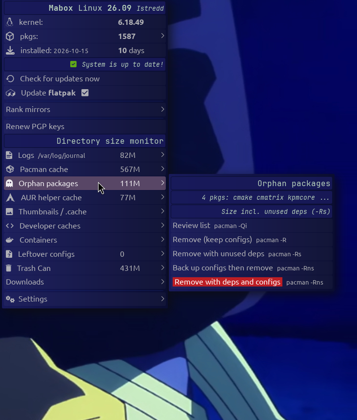
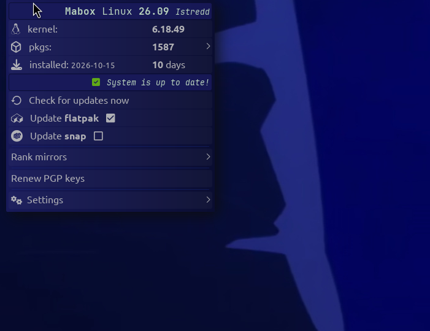
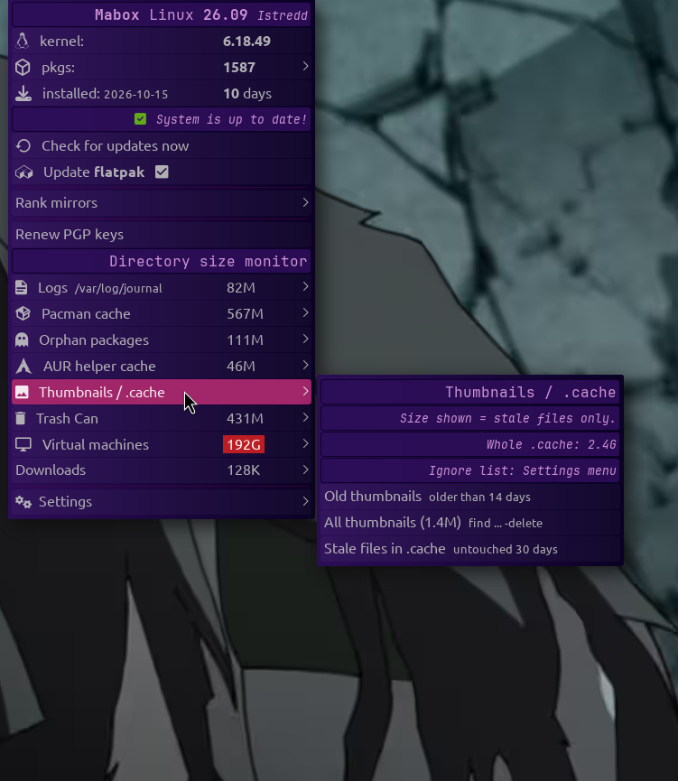
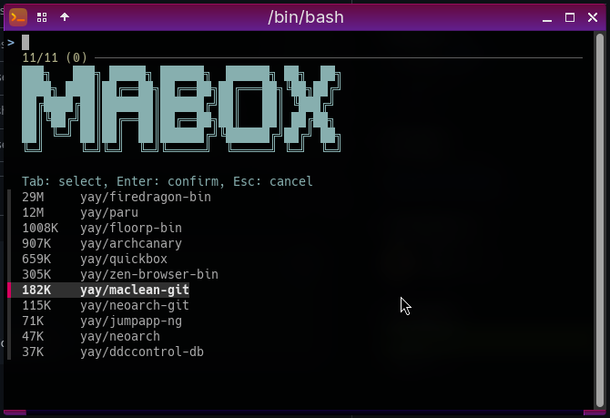
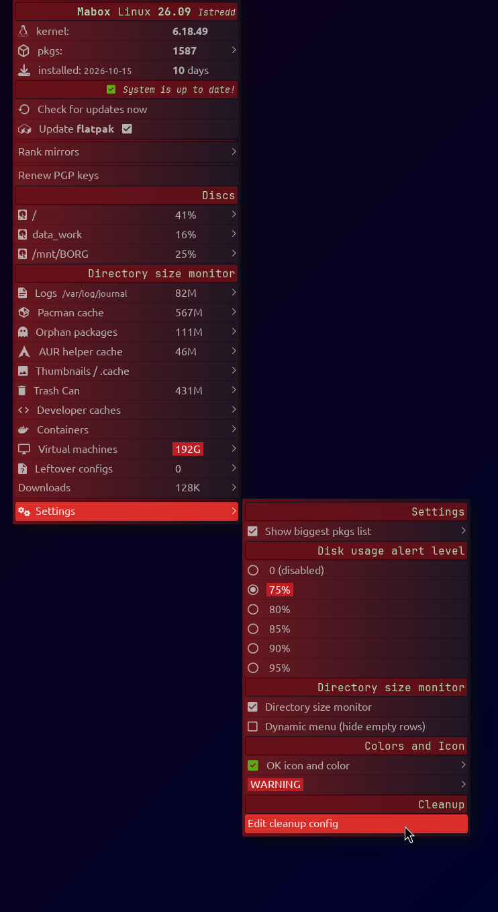
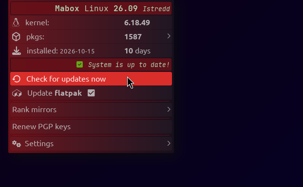
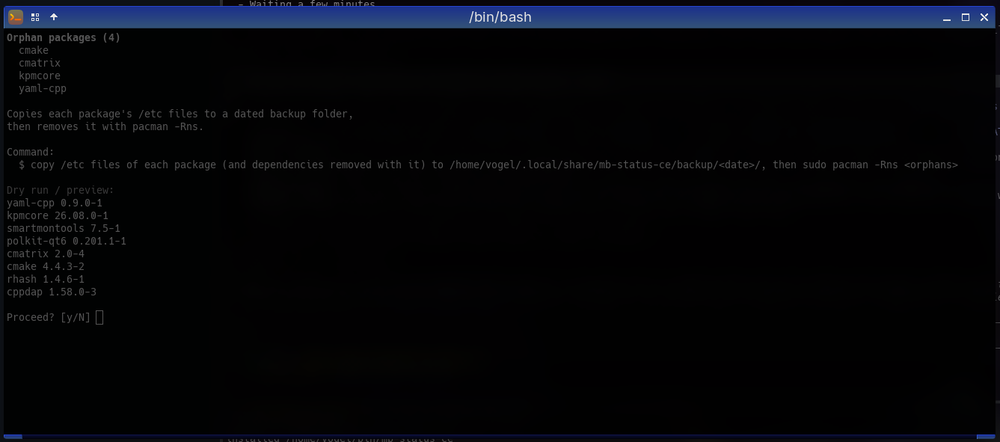
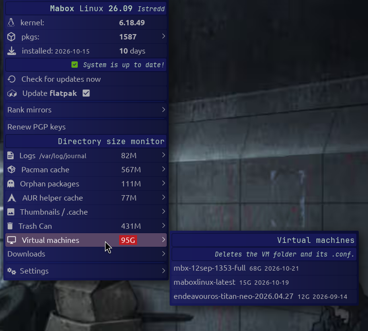
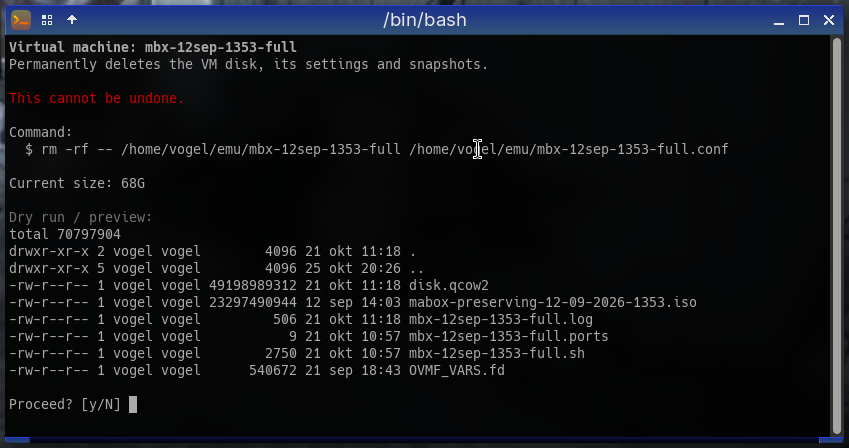

```
███╗   ███╗ █████╗ ██████╗  ██████╗ ██╗  ██╗
████╗ ████║██╔══██╗██╔══██╗██╔═══██╗╚██╗██╔╝
██╔████╔██║███████║██████╔╝██║   ██║ ╚███╔╝ 
██║╚██╔╝██║██╔══██║██╔══██╗██║   ██║ ██╔██╗ 
██║ ╚═╝ ██║██║  ██║██████╔╝╚██████╔╝██╔╝ ██╗
╚═╝     ╚═╝╚═╝  ╚═╝╚═════╝  ╚═════╝ ╚═╝  ╚═╝  Community.
```

# mb-status-ce

Fork of Mabox `mb-status` (jgmenu status menu). Same menu, plus:

- **Directory size monitor** section: journal logs, pacman cache, orphan packages, AUR helper cache, thumbnails and `~/.cache`, developer caches, containers, virtual machines, leftover configs, trash.

  Dynamic menu (default): a row shows only when there is something to clean. Settings → *Dynamic menu* off shows every row of the installed tools. Settings → *Directory size monitor* off hides the section and leaves the slim update menu.
- **Update** section: a checkbox behind *Update flatpak* and *Update snap*. Each row shows only if that tool is installed.

  Ticked: the pending updates show in the panel count, and the update runs after *Update with pacman/paru/yay*. Clicking the row only toggles the box.
- Nerd Font icons per entry.

<table>
<tr>
<td align="center"><br>Full menu</td>
<td align="center"><br>Slim menu (monitor off) and Settings</td>
<td align="center"><br>Thumbnails / .cache</td>
</tr>
<tr>
<td align="center"><br>AUR helper cache: choose packages to remove (fzf)</td>
<td align="center"><br>Full menu and Settings</td>
<td align="center"><br>Slim menu</td>
</tr>
</table>

Entries for tools that are not installed are hidden:

- AUR helper cache: needs `paru`, `yay` or `pamac`. *Choose packages to remove* also needs `fzf`.
- Developer caches: only `go`, `npm`, `cargo-cache`, `pip`, `yarn`, `pnpm` that exist.
- Containers: only `docker`, `flatpak`, `snap` that exist.
- Virtual machines: needs a `qemu_dir` folder with quickemu VMs.
- Leftover configs: needs `pacdiff`. "Review and merge" also needs `meld`.
- Update flatpak / snap rows: need `flatpak` / `snap` (snap also needs `snapd.socket` running).

Every cleanup action opens a terminal, shows the command and a preview, and asks before it runs. Root commands use `sudo`.

Orphan packages, *Back up configs then remove*:



Virtual machines: quickemu VMs from the `qemu_dir` folders (default `~/emu`), grouped by folder, with size and last change per VM:



Deleting a VM asks first and shows what goes:



## Configuration

`~/.config/mabox/mb-status-ce.conf` is created on first run. Open it with *Settings → Edit cleanup config*.

- `cache_days`: days without access before a file in `~/.cache` counts as stale.
- `thumb_days`: same for `~/.cache/thumbnails`.
- `cache_ignore`: names in `~/.cache` that are never touched.
- `update_flatpak`, `update_snap`: the checkboxes (`y` or `n`).
- `qemu_dir`: folders with quickemu VMs (`<name>.conf` next to a `<name>/` folder), comma separated, default `~/emu`. Example: `qemu_dir=~/emu, /mnt/data_work/emu`.
- `dynamic_menu`: `y` hides cleanup rows with nothing to clean, `n` shows every row of the tools you have installed (checkbox in Settings).

The *Directory size monitor* checkbox is stored in `~/.config/mabox/mabox.conf` (`dir_size_monitor`), not in this file.

### Default config

```
# mb-status-ce cleanup settings
# days without access/modification before a file in ~/.cache counts as stale
cache_days=30
# same for ~/.cache/thumbnails
thumb_days=14
# top-level names in ~/.cache that are never touched (space separated)
cache_ignore=borg betterlockscreen mozilla firefox floorp waterfox firedragon zen chromium google-chrome BraveSoftware vivaldi librewolf paru yay pamac mabox jgmenu mb-status-ce fontconfig
# Update flatpak / snap checkboxes (y or n)
update_flatpak=n
update_snap=n
# y hides cleanup rows with nothing to clean, n shows every row of the installed tools
dynamic_menu=y
# folders with quickemu VMs, comma separated (<name>.conf next to a <name>/ folder)
qemu_dir=~/emu
```

The pending flatpak and snap counts refresh in the background when the panel updates, at most every 3 hours. Run the check now with `mb-status-ce run appcheck`.

## Install

```
git clone https://github.com/musqz/mb-status-ce.git
cd mb-status-ce
./install.sh
```

Installs `~/bin/mb-status-ce` and `~/.local/share/mb-status-ce/`. Make sure `~/bin` is in `PATH` (default on Mabox).

System-wide:

```
PREFIX=/usr SUDO=sudo ./install.sh
```

## Uninstall

```
./install.sh --uninstall
```

Use the same `PREFIX` and `SUDO` as for the install. Your config `~/.config/mabox/mb-status-ce.conf` is kept.


## Mabox build

`packaging/mabox-dropin.sh` writes `dist/mabox/`: the script as `mb-status`, its helper under `usr/share/mb-status/` and `mb-status.diff` against the installed `mb-status`.

Download `mb-status.diff` from the [latest release](https://github.com/musqz/mb-status-ce/releases/latest) or build it, then apply it to a stock `mabox-tools` install: `cd / && sudo patch -p1 < mb-status.diff`. It uses `~/.config/mabox/mb-status.conf` for the cleanup settings.

## Usage

Replace the `mb-status` commands in your tint2 panel (`~/.config/tint2/*.tint2rc`):

```
execp_command = mb-status-ce status
execp_lclick_command = mb-status-ce left
execp_rclick_command = mb-status-ce menu
```

Restart tint2 afterwards. Open the menu from a terminal or keybinding: `mb-status-ce menu`.

Requires Mabox (`jgmenu`, `mb-jgtools`) and a Nerd Font.
