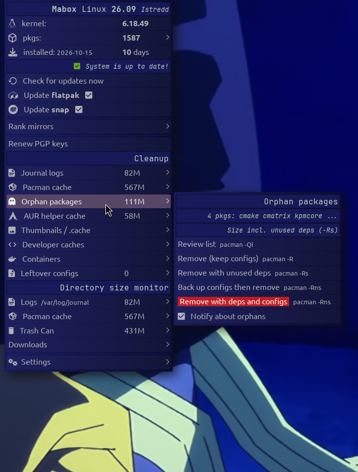

```
███╗   ███╗ █████╗ ██████╗  ██████╗ ██╗  ██╗
████╗ ████║██╔══██╗██╔══██╗██╔═══██╗╚██╗██╔╝
██╔████╔██║███████║██████╔╝██║   ██║ ╚███╔╝ 
██║╚██╔╝██║██╔══██║██╔══██╗██║   ██║ ██╔██╗ 
██║ ╚═╝ ██║██║  ██║██████╔╝╚██████╔╝██╔╝ ██╗
╚═╝     ╚═╝╚═╝  ╚═╝╚═════╝  ╚═════╝ ╚═╝  ╚═╝  Community.
```

# mb-status-ce

Fork of Mabox `mb-status` (jgmenu status menu). Same menu, plus:

- **Cleanup** section: journal logs, pacman cache, orphan packages, AUR helper cache, thumbnails and `~/.cache`, developer caches, containers, leftover configs.
- **Update** section: a checkbox behind *Update flatpak* and *Update snap*. Ticked: the pending updates show in the panel count, and the update runs after *Update with pacman/paru/yay*. Clicking the row only toggles the box.
- Nerd Font icons per entry.




Entries for tools that are not installed are hidden:

- AUR helper cache: needs `paru`, `yay` or `pamac`.
- Developer caches: only `go`, `npm`, `cargo-cache`, `pip`, `yarn`, `pnpm` that exist.
- Containers: only `docker`, `flatpak`, `snap` that exist.
- Leftover configs: needs `pacdiff`. "Review and merge" also needs `meld`.
- Update flatpak / snap rows: need `flatpak` / `snap` (snap also needs `snapd.socket` running).

Every cleanup action opens a terminal, shows the command and a preview, and asks before it runs. Root commands use `sudo`.

## Configuration

`~/.config/mabox/mb-status-ce.conf` is created on first run. Open it with *Settings → Edit cleanup config*.

- `cache_days`: days without access before a file in `~/.cache` counts as stale.
- `thumb_days`: same for `~/.cache/thumbnails`.
- `cache_ignore`: names in `~/.cache` that are never touched.
- `update_flatpak`, `update_snap`: the checkboxes (`y` or `n`).
- `notify_orphans`: `y` shows a desktop notice when the orphan count changes, with *Review* and *Back up and remove* buttons (checkbox in the Orphan packages submenu, needs `notify-send.sh`).

The pending flatpak and snap counts and the orphan notice come from a user timer (`mb-status-ce-appcheck.timer`, every 3 hours). Run the checks now with `mb-status-ce run appcheck` and `mb-status-ce run orphancheck`.

## Install

```
git clone https://codeberg.org/linux-bird/mb-status-ce.git
cd mb-status-ce
./install.sh
```

Installs `~/bin/mb-status-ce`, `~/.local/share/mb-status-ce/` and enables the timer `mb-status-ce-appcheck.timer`. Make sure `~/bin` is in `PATH` (default on Mabox).

System-wide:

```
PREFIX=/usr SUDO=sudo ./install.sh
systemctl --user enable --now mb-status-ce-appcheck.timer
```

## Uninstall

```
./install.sh --uninstall
```

Use the same `PREFIX` and `SUDO` as for the install. Your config `~/.config/mabox/mb-status-ce.conf` is kept.

After a system-wide install, run `systemctl --user disable --now mb-status-ce-appcheck.timer` first.

## Usage

Replace the `mb-status` commands in your tint2 panel (`~/.config/tint2/*.tint2rc`):

```
execp_command = mb-status-ce status
execp_lclick_command = mb-status-ce left
execp_rclick_command = mb-status-ce menu
```

Restart tint2 afterwards. Open the menu from a terminal or keybinding: `mb-status-ce menu`.

Requires Mabox (`jgmenu`, `mb-jgtools`) and a Nerd Font.
